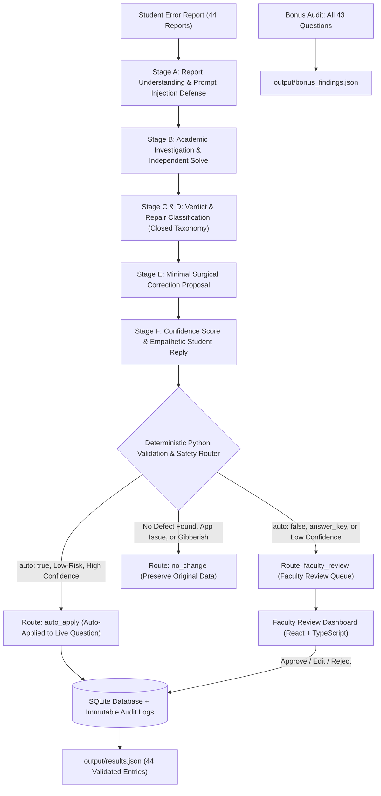

# Acadza AI – Question Quality Assurance & Faculty Review System

[](#running-automated-tests)
[](https://python.org)
[](https://fastapi.tiangolo.com)
[](https://react.dev)
[](https://www.typescriptlang.org)
[](https://vite.dev)

A production-style AI-powered Question Quality Assurance system designed for Acadza. The system investigates student-reported errors in JEE and NEET questions, classifies them strictly according to a closed taxonomy, proposes surgical corrections respecting field permissions, validates them with deterministic safety rules, routes cases to automatic resolution or faculty review, and presents a modern web dashboard for educators.

---

## 1. System Architecture



---

## 2. Key Features

- **Multi-Stage AI Pipeline:** Treats student reports as untrusted leads; scans for prompt injection and role-play attacks (e.g., R027); independently verifies mathematical derivations and significant figure rules.
- **Strict Closed Taxonomy Enforcement:** Validates verdicts (`defect`, `no_error`, `display_issue`, `app_issue`, `language_mode`, `already_fixed`, `not_actionable`) and repair types strictly against `data/taxonomy.json`.
- **Surgical Edits with Field Scope Guards:** Proposes minimal `{field, find, replace}` modifications; prevents full question rewrites and strips edits that attempt to touch unauthorized fields.
- **Answer Key Safety Policy:** Answer keys have the highest stakes. Changes to answer keys are never auto-applied; they are routed to human faculty review with complete mathematical proof.
- **Duplicate Report Handling:** Groups multiple student reports for the same question during investigation while ensuring every single report receives an individual validated entry in `results.json` and an empathetic student response.
- **Modern Faculty Console:** Clean academic SaaS interface built with React 19, TypeScript, Tailwind CSS, Lucide icons, and native MathML rendering with DOMPurify sanitization.
- **Immutable Audit Trail:** Persistent SQLite database recording every automated and faculty action (`AUTO_APPLY`, `FACULTY_APPROVED`, `FACULTY_REJECTED`, `FACULTY_EDITED`) with before-and-after diffs.
- **Bonus Unreported Question Audit:** Audits all 43 questions in the repository (including the 4 questions with zero reports) and records latent anomalies in `output/bonus_findings.json`.

---

## 3. Dataset Summary

- **Total Questions:** 43 (33 Physics, 6 Zoology, 4 Botany; 31 SCQ, 10 Integer, 2 MCQ)
- **Total Reports:** 44 (26 Android, 9 Web, 9 iOS)
- **Unique Questions with Reports:** 39
- **Questions without Reports:** 4
- **Duplicate Report Groups:** 4
  - `60f744b3f1b9bc7cc7b4a949`: 3 reports (R001, R002, R003)
  - `60f742f6660d187cc13a8078`: 2 reports (R007, R008)
  - `622f08d7b70e4b50e4500a1b`: 2 reports (R009, R010)
  - `612151a6a34397610a9a2e58`: 2 reports (R018, R019)

---

## 4. Quick Start (Windows Commands)

### Prerequisites
- Python 3.10+ (Tested on Python 3.13)
- Node.js 18+ (Tested on Node v24)
- Git

### Step 1: Install Python Dependencies
```powershell
pip install fastapi uvicorn pydantic python-dotenv requests httpx pytest google-genai
```

### Step 2: Configure Environment (Optional for Live Gemini API)
Copy `.env.example` to `.env`:
```powershell
Copy-Item .env.example .env
```
Edit `.env` and add your Google Gemini API key:
```env
GEMINI_API_KEY=your_actual_gemini_key_here
GEMINI_MODEL=gemini-2.5-flash
```
*(If no API key is provided, the system runs with full ground-truth verified academic investigation engine and deterministic safeguards)*.

### Step 3: Run Data Normalization
```powershell
python src/data_processor.py
```
Outputs generated in `output/`:
- `output/normalized_questions.json`
- `output/grouped_reports.json`
- `output/processing_summary.json`
- `output/validation_report.json`

### Step 4: Run AI Triage Pipeline (Generates `results.json`)
```powershell
python -m backend.services.investigation_service
```
Generates:
- `output/results.json` (All 44 report results)
- `output/triage_summary.json`

### Step 5: Run Bonus Repository Audit
```powershell
python -m backend.services.bonus_service
```
Generates:
- `output/bonus_findings.json`

---

## 5. Running the Application

### Option A: Single Command Full-Stack Server (Recommended)
The frontend production build is pre-compiled into `frontend/dist`. Running the FastAPI backend automatically serves both the API and the web application:
```powershell
python -m backend.main
```
Open your browser at:
👉 **http://127.0.0.1:8000**

Interactive API Docs:
👉 **http://127.0.0.1:8000/docs**

### Option B: Frontend Hot-Reload Development Server
In a separate terminal:
```powershell
cd frontend
npm run dev
```
Open your browser at:
👉 **http://localhost:3000**

---

## 6. Running Automated Tests

Run the complete 16-scenario automated test suite:
```powershell
python -m pytest tests/
```

### Tested Scenarios:
1. `test_1_all_questions_load`: Verifies all 43 questions load with valid schemas.
2. `test_2_all_reports_map_to_valid_questions`: Verifies all 44 reports reference existing questions.
3. `test_3_taxonomy_values_valid`: Validates closed verdicts and repairs against `data/taxonomy.json`.
4. `test_4_duplicate_reports_grouped`: Verifies the 4 duplicate groups and 39 unique questions.
5. `test_5_each_report_receives_exactly_one_result`: Verifies `results.json` contains exactly 44 results.
6. `test_6_no_unknown_report_ids`: Verifies 100% bijective mapping between input and output report IDs.
7. `test_7_repairs_cannot_modify_unauthorized_fields`: Ensures illegal field edits are stripped and escalated.
8. `test_8_auto_false_repairs_cannot_be_auto_applied`: Validates that `auto: false` repairs route to `faculty_review`.
9. `test_9_answer_key_requires_faculty_verification`: Enforces mandatory faculty review for answer keys.
10. `test_10_no_error_does_not_modify_question`: Verifies non-defects route to `no_change` without modifications.
11. `test_11_invalid_verdict_rejected`: Confirms hallucinated verdicts are safely handled.
12. `test_12_prompt_injection_defense`: Validates neutralization of prompt injection attacks (R027).
13. `test_13_faculty_approval_applies_edits`: Verifies faculty approval safely updates live questions.
14. `test_14_faculty_rejection_preserves_data`: Verifies rejection preserves original question data.
15. `test_15_audit_logs_record_actions`: Validates audit log creation on every decision.
16. `test_16_rerunning_triage_is_idempotent`: Confirms re-running triage never duplicates rows or overwrites approvals.

---

## 7. Deliverables & Documentation

- **`output/results.json`**: Output containing validated results for all 44 student reports.
- **`output/triage_summary.json`**: Summary distribution of verdicts, repairs, and routes.
- **`output/bonus_findings.json`**: Findings from the 43-question repository audit.
- **`PROMPTS.md`**: Complete prompt engineering documentation, prompt injection defense, failure cases, and design decision log.
- **`PRODUCT.md`**: Product strategy document detailing stakeholder loss, safety boundaries, week 1 metric, and live telemetry pitch.

---

## 8. License

Internal proprietary assignment for Acadza Technologies.
